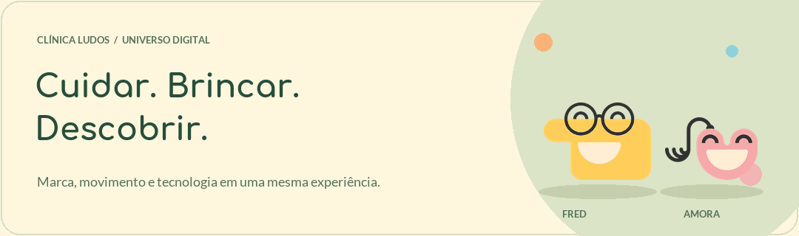
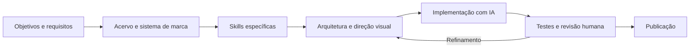
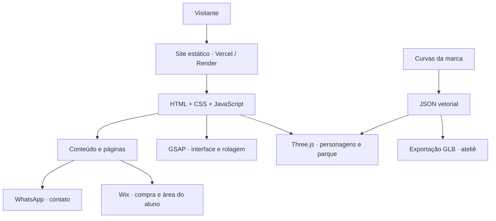

**🌐 [ABRIR O SITE NA VERCEL →](https://site-ludos.vercel.app/)** · [☁️ Versão no Render](https://site-ludos.onrender.com/) · [🧸 Ateliê 3D](https://site-ludos.vercel.app/modelos.html)

<a id="topo"></a>

# 🌱 Clínica Ludos · Um universo de cuidado e descobertas

<picture>
  <source media="(prefers-reduced-motion: reduce)" srcset="docs/assets/ludos-readme.png">
  
</picture>

<p align="center">
  <strong>Uma marca que acolhe. Uma experiência que se move.</strong><br>
  Psicologia para crianças e adolescentes · Formação para estudantes e profissionais
</p>

<p align="center">
  
  
  
  
</p>

> **O projeto em uma frase**<br>
> Traduzir a identidade da Clínica Ludos em um site com conteúdo acolhedor, caminhos claros para atendimento e cursos, personagens tridimensionais e uma narrativa de movimento ligada à rolagem.

**Explore:** [Projeto](#projeto) · [Criação com IA](#criacao-com-ia) · [Skills](#skills) · [Design](#design) · [Parque 3D](#parque-3d) · [Arquitetura](#arquitetura) · [Executar](#executar) · [Publicação](#publicacao) · [Evolução](#evolucao)

---

<a id="projeto"></a>

## ✨ Uma experiência com a personalidade da Ludos

A Ludos trabalha com **psicoterapia infantojuvenil** e **avaliação neuropsicológica**. O site apresenta a clínica aos pais e responsáveis, aproxima o visitante do espaço e facilita o primeiro contato pelo WhatsApp. Uma segunda jornada atende estudantes de psicologia, recém-formados e profissionais interessados nos cursos.

A direção visual parte do manual, das fontes, dos personagens, dos elementos gráficos e do acervo da clínica. A construção evoluiu por etapas: levantamento, definição de guias, primeira versão navegável, refinamento de páginas internas e desenvolvimento do parque interativo.

| Jornada | O que o visitante encontra | Próximo passo |
| :--- | :--- | :--- |
| 💚 Atendimento | Proposta de cuidado, serviços e dúvidas frequentes | Conversar pelo WhatsApp |
| 🏡 Conhecer a clínica | Ambientes, vídeo e apresentação de Paula Joly | Entender o acolhimento e entrar em contato |
| 📚 Formação | Informações, conteúdo e condições dos cursos | Seguir para a compra ou área do aluno na Wix |
| 🎠 Descobrir a marca | Personagens, brinquedos e animações durante a rolagem | Explorar o universo Ludos |

### 🗺️ Páginas para explorar

| Página | Endereço de teste |
| :--- | :--- |
| Início | [Página principal ↗](https://site-ludos.vercel.app/) |
| Psicoterapia infantojuvenil | [/psicoterapiainfantojuvenil ↗](https://site-ludos.vercel.app/psicoterapiainfantojuvenil) |
| Avaliação neuropsicológica | [/avaliacaoneuropsicologica ↗](https://site-ludos.vercel.app/avaliacaoneuropsicologica) |
| Cursos | [/cursos ↗](https://site-ludos.vercel.app/cursos) |
| Neuropsicologia: Primeiros Passos | [/cursoneuropsi ↗](https://site-ludos.vercel.app/cursoneuropsi) |
| Personalidade e Psicopatologia | [/cursopersonalidadeepsicopatologia ↗](https://site-ludos.vercel.app/cursopersonalidadeepsicopatologia) |
| Ateliê dos personagens | [/modelos.html ↗](https://site-ludos.vercel.app/modelos.html) |

---

<a id="criacao-com-ia"></a>

## 🧠 Como este projeto foi criado com IA

### Desenvolvimento assistido por IA, orientado por requisitos e sistema de design

Essa é a descrição adotada para o processo deste projeto.[^metodo] Antes da implementação, foram organizados os objetivos, os públicos, os serviços, as ofertas existentes, a identidade visual e as possibilidades de integração com a Wix. Esse conhecimento foi transformado em **skills específicas**, usadas para orientar as decisões de arquitetura, conteúdo, design, movimento, 3D e validação.

A IA participou da análise do acervo, da documentação e da implementação, com **direção criativa, requisitos e validações conduzidos por Pedro Giffoni**. As revisões do projeto definiram comportamentos concretos: como o personagem pousa, em que plano passa pela rampa, como gira na saída de um tubo e quando continua balançando.

> **Nome curto para apresentar o trabalho:**<br>
> **Engenharia de experiência digital assistida por IA.**<br>
> *Com requisitos documentados, sistema de marca e skills especializadas.*

| Camada do processo | Como apareceu neste projeto |
| :--- | :--- |
| **Direção humana** | Objetivos, referências, prioridades e aprovação das versões |
| **Requisitos documentados** | Públicos, páginas, contato, serviços, cursos e estados comerciais |
| **Sistema de marca** | Paleta, tipografia, personagens, proporções e linguagem visual |
| **Skills do projeto** | Instruções reutilizáveis para cada disciplina da construção |
| **Implementação com IA** | Código, geometria, animação, preparação de mídia e documentação |
| **Validação iterativa** | Testes, build, revisão visual em navegador e ajustes por feedback |
| **Versionamento e entrega** | Branches de evolução, commits e publicação em dois ambientes |



A memória do processo está no [registro de implementação](planejamento/primeira-versao.md) e nas [referências de requisitos](skills/ludos-design/references/requisitos.md). Esses documentos registram decisões, mudanças de direção e limites de cada etapa.

<a id="skills"></a>

## 🧩 Oito skills, uma direção de projeto

As skills são guias locais em Markdown, com responsabilidades e referências próprias. Elas organizam o contexto usado durante o desenvolvimento com IA e podem ser consultadas por quem continuar o trabalho.

| Skill | Responsabilidade |
| :--- | :--- |
| [🧭 Projeto](skills/ludos-projeto/SKILL.md) | Coordenar etapas, fontes de verdade e escolha dos guias pertinentes |
| [🏗️ Arquitetura e Wix](skills/ludos-arquitetura-wix/SKILL.md) | Estrutura do frontend, fronteiras de integração e recursos da plataforma |
| [🎨 Design](skills/ludos-design/SKILL.md) | Identidade, direção de arte, componentes e uso do acervo |
| [✍️ Conteúdo e conversão](skills/ludos-conteudo-conversao/SKILL.md) | Hierarquia de informação, texto e caminhos para contato e cursos |
| [🎞️ Motion](skills/ludos-motion/SKILL.md) | Ritmo, coreografia, interação e experiência com movimento reduzido |
| [🧸 Three.js](skills/ludos-threejs/SKILL.md) | Personagens, modelagem, cenas, materiais e execução do 3D |
| [📷 Mídia](skills/ludos-midia/SKILL.md) | Seleção e preparação de fotos, vídeos e ativos visuais |
| [🔎 Validação](skills/ludos-validacao/SKILL.md) | Acessibilidade, desempenho, regressões e critérios de entrega |

**Comece por [ludos-projeto](skills/ludos-projeto/SKILL.md)** e carregue os demais guias conforme a tarefa. As referências de [experiência](skills/ludos-design/references/experiencia.md), [identidade e acervo](skills/ludos-design/references/identidade-e-acervo.md) e [cursos](skills/ludos-design/references/cursos.md) complementam o conjunto.

---

<a id="design"></a>

## 🎨 Da identidade visual ao espaço tridimensional

A experiência mantém as cores suaves, as formas arredondadas e a expressão dos personagens. A tipografia combina **Comfortaa** nos títulos e **Lato** no texto. Fotos reais aproximam o visitante do ambiente da clínica.

| Cor | Valor | Papel na composição |
| :--- | :---: | :--- |
| 🌿 Verde suave | `#AFC8A0` | Fundos, estruturas e universo da marca |
| 🌸 Rosa | `#F3B4B4` | Amora, bordas e detalhes lúdicos |
| 🫧 Azul | `#8DD1DC` | Superfícies e elementos do parque |
| ☀️ Amarelo | `#FFD86E` | Fred e pontos de destaque |
| 🍊 Laranja | `#FBB277` | Edy e peças de apoio |
| 🥛 Creme | `#FFF6DE` | Base clara, tampos e respiro visual |
| 🌲 Verde escuro | `#264E3B` | Texto, contraste e áreas de contato |

### 🧸 Cinco personagens com volume

**Fred · Amora · Edy · Jr · Zoe**

Os modelos atuais derivam das **curvas vetoriais originais** do arquivo Illustrator fornecido com a marca. As curvas são convertidas em geometrias extrudadas, com espessura, bordas arredondadas, rosto e acessórios separados. A escala é uniforme para preservar as proporções.

- **Materiais:** acabamento físico com controle de rugosidade e clearcoat.
- **Detalhes:** expressão e acessórios em peças próprias para movimentos secundários.
- **Arquivos:** versões GLB para inspeção e uso em ferramentas 3D compatíveis.
- **Ateliê:** arraste, zoom, troca de personagem e botões para experimentar acrobacias.

**[Abrir o ateliê 3D →](https://site-ludos.vercel.app/modelos.html)**

<a id="parque-3d"></a>

## 🎠 Uma história que acompanha a rolagem

O personagem sai da composição inicial e percorre um parque lateral. O movimento acompanha a posição da página; ao subir a rolagem, o visitante refaz o caminho.

| Momento | Comportamento |
| :--- | :--- |
| **Abertura** | A composição apresenta os cinco amigos da marca |
| **Alternância** | Fred e Amora se revezam a cada nova entrada ou recarregamento da home |
| **Plataformas** | O personagem pousa, faz uma pausa e salta com uma acrobacia |
| **Escorregador aberto** | Pousa no patamar, dá uma cambalhotinha e desliza pela frente da rampa |
| **Tubos fechados** | Desce por dentro, visível através da janela curva de acrílico |
| **Saída dos tubos** | Gira 360° no eixo vertical enquanto continua descendo |
| **Balanço final** | Pousa no assento e oscila continuamente enquanto permanece na chegada |
| **Retorno** | A rolagem para cima retoma a trajetória anterior |

<details>
<summary><strong>⚙️ Como a coreografia funciona</strong></summary>

A trajetória em [park-path.js](site/src/park-path.js) transforma a posição de rolagem em posição, escala, inclinação e rotação. Os apoios usam a base real da geometria do personagem. O contato com bolas considera sua superfície curva; o assento e o personagem compartilham o mesmo movimento pendular.

Os brinquedos são construídos em [park-models.js](site/src/park-models.js). O [HomePark](site/src/home-park.js) reúne os objetos, calcula suas posições no documento e coordena o personagem com cada etapa.

A preferência de alternância usa o armazenamento local do navegador: **amarelo → rosa → amarelo → rosa**. Ela continua entre visitas no mesmo navegador. Ao apagar os dados do site, a sequência recomeça; quando o armazenamento está bloqueado, Fred é a alternativa disponível.

O parque renderiza por eventos durante o percurso. A abertura e o balanço ativo têm animação contínua; a execução é suspensa quando a aba fica oculta. O modo reduzido mantém a apresentação estática.

</details>

### ♿ Movimento com alternativas

- Preferência do sistema por redução de movimento respeitada.
- Controle de movimento disponível no rodapé.
- Composição estática quando o 3D não está disponível.
- Espaço lateral adaptado para desktop e celular.
- Conteúdo das páginas principais e internas presente no HTML gerado.

> [!TIP]
> O banner deste README é um GIF local de apresentação da marca. Para experimentar o parque, o acrílico, os giros e o balanço, abra o **[site de teste](https://site-ludos.vercel.app/)**. A alternativa estática do banner está em [PNG](docs/assets/ludos-readme.png).

---

<a id="arquitetura"></a>

## 🏗️ Arquitetura do projeto

O frontend usa **JavaScript com ES Modules**, **Three.js**, **GSAP** e **Vite**. O build gera o site estático, as páginas internas pré-renderizadas e um bundle separado do componente 3D para estudos de integração.



### 🔌 A relação com a Wix

A nova experiência visual está publicada separadamente. Os destinos comerciais existentes continuam na Wix: compra, eventos, programas online e acesso às aulas e materiais.

| Responsabilidade | Situação atual |
| :--- | :--- |
| Apresentação, serviços, cursos e experiência 3D | Frontend deste repositório |
| Contato para atendimento | Links para WhatsApp |
| Compra e acesso ao programa de Neuropsicologia | Destino nativo Wix |
| Personalidade e Psicopatologia | Página informativa com inscrições encerradas |
| Teste do componente 3D isolado | Harness local em `site/wix-demo.html` |
| Instalação da nova experiência dentro da Wix | Validação de integração pendente |

> [!IMPORTANT]
> O build estático **não é importado diretamente no Wix Editor**. O bundle `dist-element/ludos-scene.js` prepara um componente isolado para uma prova de integração; o funcionamento dentro da Wix ainda precisa ser validado. O checkout e o acesso autenticado do aluno também exigem conferência na plataforma.

<details>
<summary><strong>📚 Estados comerciais documentados</strong></summary>

- **Neuropsicologia: Primeiros Passos:** oferta documentada com Artur Menezes, 8 aulas gravadas, investimento de R$ 199 e 12 meses de acesso. Compra e área do aluno seguem para a Wix.
- **Personalidade e Psicopatologia:** inscrições encerradas; a página preserva as informações do curso e o contato para participantes.

Ao alterar valores, disponibilidade ou condições, consulte primeiro [a referência de cursos](skills/ludos-design/references/cursos.md) e reconcilie o conteúdo das páginas e os destinos Wix.

</details>

### 🗂️ Mapa do repositório

```text
site-ludos/
├── README.md                      # Apresentação e guia de desenvolvimento
├── docs/assets/                    # Banner animado e alternativa estática
├── skills/                         # Oito guias específicos do projeto
├── planejamento/                   # Histórico e decisões de implementação
├── elementos/                      # Personagens e vetores originais
├── logo/                           # Arquivos da identidade
├── modelos para instagram/         # Referências gráficas da marca
├── MANUAL_LUDOS.pdf                # Manual fornecido para o projeto
└── site/
    ├── index.html                  # Página principal
    ├── modelos.html                # Ateliê interativo
    ├── wix-demo.html               # Harness local do componente isolado
    ├── src/
    │   ├── main.js                 # Inicialização e interface
    │   ├── pages.js                # Mapa das páginas internas
    │   ├── service-pages.js        # Conteúdo dos serviços
    │   ├── course-pages.js         # Conteúdo dos cursos
    │   ├── scene.js                # Cena, renderização e ciclo de vida
    │   ├── character-models.js     # Construção dos modelos vetoriais
    │   ├── vector-characters.json  # Curvas originais preparadas
    │   ├── home-park.js            # Coordenação do parque
    │   ├── park-models.js          # Brinquedos, tubos e balanço
    │   ├── park-path.js            # Trajetória e movimento pendular
    │   ├── park-character.js       # Alternância Fred / Amora
    │   └── config.js               # Destinos de contato e cursos
    ├── public/
    │   ├── assets/                 # Imagens, fontes e vídeo usados pelo site
    │   └── models/                 # Modelos GLB exportados
    ├── scripts/                    # Preparação de ativos e pré-renderização
    ├── tests/                      # Testes de comportamento e geometria
    ├── vite.config.js              # Build do site e do ateliê
    ├── vite.element.config.js      # Bundle isolado do componente 3D
    └── vercel.json                 # Configuração de build para Vercel
```

O acervo bruto de fotos, vídeos e fontes, as dependências instaladas e as saídas de build permanecem fora do Git conforme o [`.gitignore`](.gitignore). Os derivados necessários para executar o site estão no repositório.

---

<a id="executar"></a>

## 🚀 Executar localmente

**Pré-requisitos:** Git, npm e Node.js compatível com Vite 8. O projeto foi publicado usando Node.js 22; para desenvolvimento, use **22.12 ou superior na linha 22**.

```bash
# 1. Obtenha o projeto e a branch de trabalho
git clone https://github.com/PedroGiffoni/site-ludos.git
cd site-ludos
git switch developer-3

# 2. Instale as versões registradas no lockfile
cd site
npm ci

# 3. Inicie a prévia
npm run dev
```

O endereço padrão é `http://127.0.0.1:5173/`. Se a porta estiver ocupada, o Vite informa outra disponível. No Windows, também é possível executar [`site/INICIAR.cmd`](site/INICIAR.cmd) após instalar as dependências.

### 🛠️ Comandos disponíveis

Execute dentro de `site/`:

| Comando | Resultado |
| :--- | :--- |
| `npm run dev` | Servidor local com atualização durante o desenvolvimento |
| `npm test` | Testes com o runner nativo do Node.js |
| `npm run build` | Site estático, páginas internas e componente isolado |
| `npm run preview` | Prévia local do build em `dist/` |
| `npm run models` | Reexportação dos cinco personagens em GLB |

**Saídas do build:**

```text
dist/                         → Site estático e páginas internas
dist/modelos.html             → Ateliê 3D
dist-element/ludos-scene.js    → Componente 3D isolado
```

<details>
<summary><strong>🧰 Regenerar vetores, modelos e banner do README</strong></summary>

O desenvolvimento normal usa os ativos já preparados. Python só é necessário para regenerar os derivados correspondentes.

Na raiz do repositório:

```bash
# Dependências dos scripts de preparação
python -m pip install Pillow PyMuPDF

# Reextrair as curvas do Illustrator fornecido
python site/scripts/prepare-vector-characters.py

# Reexportar os modelos GLB
npm --prefix site run models

# Recriar o banner animado e sua alternativa estática
python site/scripts/generate-readme-banner.py
```

A exportação GLB usa `GLTFExporter`, do Three.js. O banner usa Pillow, as fontes locais e as imagens originais dos personagens, com proporções preservadas.

</details>

<details>
<summary><strong>🩹 Dúvidas rápidas de desenvolvimento</strong></summary>

**O PowerShell bloqueou o comando `npm`?**<br>
Use `npm.cmd ci` e `npm.cmd run dev` no mesmo diretório.

**O personagem mudou depois de atualizar a página?**<br>
É o comportamento esperado: a home alterna entre Fred e Amora.

**O personagem não anima?**<br>
Confira o controle de movimento no rodapé, a preferência de movimento reduzido do sistema e a disponibilidade de WebGL no navegador.

**O build exibiu um aviso de chunk acima de 500 kB?**<br>
O módulo compartilhado de Three.js supera esse limite de aviso. O build atual conclui; novas cenas devem considerar o custo de download e renderização.

**Preciso de uma variável de ambiente para abrir a versão atual?**<br>
O frontend atual usa configuração pública em `src/config.js` e não exige credenciais para execução local. Compra e área do aluno são destinos externos da Wix.

</details>

### ✅ O que é verificado

A versão de referência `6a15666` passou em **17 testes**, além do build. A suíte cobre:

- Alternância dos personagens e comportamento com armazenamento bloqueado.
- Continuidade da trajetória e reversão da rolagem.
- Pousos, pausas, saltos e conclusão das acrobacias.
- Descida dos tubos sem impulso para cima, com giro horizontal de 360°.
- Quique do escorregador e continuidade da rampa.
- Geometria das junções entre casco e acrílico.
- Profundidade do escorregador aberto em relação ao personagem.
- Movimento pendular e contato do personagem com o assento.
- Preservação dos destinos e condições comerciais documentadas.

As revisões visuais registradas incluem desktop, celular, movimento reduzido e cenas dos personagens. A suíte automatizada complementa essa conferência.

---

<a id="publicacao"></a>

## ☁️ Publicação e branches

| Ambiente | Link | Referência publicada |
| :--- | :--- | :--- |
| ▲ Vercel | [site-ludos.vercel.app](https://site-ludos.vercel.app/) | Commit `6a15666` da `developer-2` |
| ☁️ Render | [site-ludos.onrender.com](https://site-ludos.onrender.com/) | Commit `6a15666` da `developer-2` |
| 🧪 Trabalho atual | [Branch `developer-3`](https://github.com/PedroGiffoni/site-ludos/tree/developer-3) | Próxima etapa de evolução |

**Configuração de build:**

| Serviço | Diretório / comando | Pasta publicada |
| :--- | :--- | :--- |
| Vercel | Raiz `site` · instalação `npm ci` · build `npm run build` | `dist` |
| Render | `cd site && npm ci && npm run build` | `site/dist` |

> [!NOTE]
> O Render está configurado para acompanhar a **`developer-2`** automaticamente. A atualização de produção na Vercel foi acionada explicitamente. Um commit apenas local não publica alterações; o comportamento após um push depende da branch e da configuração de cada serviço. O trabalho na `developer-3` permanece separado da versão de referência publicada.

<details>
<summary><strong>🌿 Histórico das branches</strong></summary>

| Branch | Marco |
| :--- | :--- |
| `main` | Primeira implementação publicada no repositório |
| `developer-1` | Refinamento do parque, modelos vetoriais, tubos e pousos |
| `developer-2` | Escorregador aberto, balanço, sombras e alternância de personagens |
| `developer-3` | Continuação a partir da versão aprovada; documentação ampliada |

Os nomes representam etapas deste projeto. Consulte o histórico de commits para identificar a revisão exata de uma entrega.

</details>

<a id="evolucao"></a>

## 🧭 Continuidade do trabalho

- [x] Levantamento de requisitos e leitura do acervo de marca.
- [x] Criação das oito skills específicas.
- [x] Página principal e páginas de serviços e cursos.
- [x] Personagens vetoriais em 3D e ateliê de inspeção.
- [x] Parque com escorregador, tubos de acrílico e balanço.
- [x] Alternância Fred / Amora entre entradas na home.
- [x] Testes e publicação em Vercel e Render.
- [ ] Validação clínica final dos textos e dados profissionais.
- [ ] Inclusão de retratos aprovados para as apresentações profissionais.
- [ ] Conferência autenticada da jornada de compra e acesso do aluno na Wix.
- [ ] Prova de integração da nova experiência com o Wix Editor.

### 🤝 Como continuar com consistência

1. Leia a [skill de projeto](skills/ludos-projeto/SKILL.md) e as referências da área a alterar.
2. Confirme a branch ativa e preserve o acervo original.
3. Implemente a mudança mantendo as proporções da marca e as alternativas de movimento.
4. Execute os testes e o build; revise no navegador quando houver mudança visual ou de interação.
5. Registre decisões relevantes em [`planejamento/primeira-versao.md`](planejamento/primeira-versao.md).
6. Publique a revisão pretendida e confira o site no ambiente de destino.

---

## 💛 Créditos e autoria

**Direção do projeto e validações:** Pedro Giffoni.<br>
**Identidade e acervo de referência:** materiais da Clínica Ludos fornecidos para o projeto.<br>
**Desenvolvimento:** colaboração entre direção humana e IA, com apoio do Codex na análise, documentação, implementação e verificação.<br>
**Guias de trabalho:** skills locais construídas para as necessidades da Ludos.

O repositório ainda não contém um arquivo `LICENSE`. Os ativos de marca e as mídias devem ter sua titularidade e condições de uso consideradas em qualquer reutilização.

[^metodo]: “Desenvolvimento assistido por IA, orientado por requisitos e sistema de design” é uma descrição do processo realizado aqui. As skills são instruções específicas do projeto; não representam treinamento de um modelo de IA nem uma certificação metodológica.

<p align="center">
  <strong>Cada detalhe conta uma parte da história.</strong><br>
  🌱 <a href="https://site-ludos.vercel.app/">Explore a Ludos</a> · <a href="#topo">Voltar ao topo ↑</a>
</p>
